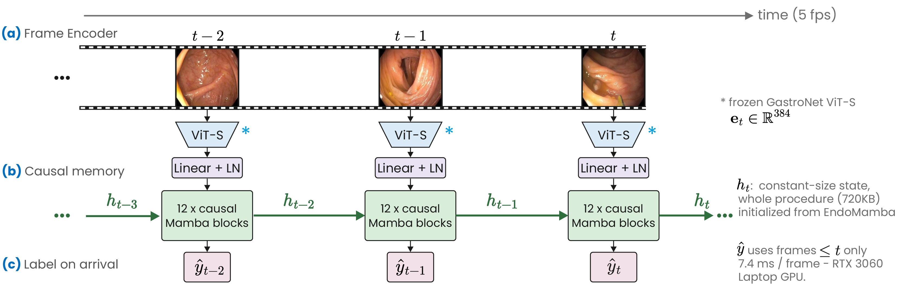
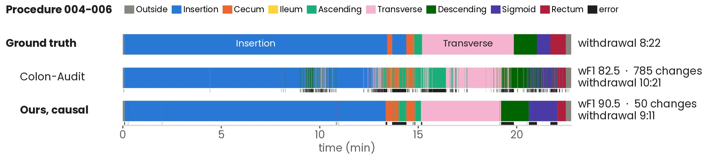

# Window-Free Memory for Real-Time Colonoscopy Auditing with State-Space Models

Colon-Audit-Mamba labels every colonoscopy frame as it arrives (outside, insertion, or one of seven colon
segments) and estimates the withdrawal time online. It is a follow-up to
[Colon-Audit](https://github.com/DiegoBravoH/Colon_Audit), which uses a temporal Vision Transformer over
588-frame windows (≈2 min). Colon-Audit-Mamba replaces those windows with a strictly causal Mamba model that
keeps a fixed-size recurrent state (720 KB) for the whole procedure.

Paper: *Window-Free Memory for Real-Time Colonoscopy Auditing with State-Space Models*, submitted to ISBI 2027.

> **Code availability.** The training scripts will be released once the paper is accepted, together with the
> model code and the scripts for the ablations, baselines and CAS-Colon evaluation. This repository currently
> provides the evaluation of Table 1, the Mamba rows of Table 2 and Figure 2, the data preparation scripts, and
> the trained models and frame-level predictions.

<p align="center">
  
</p>

**Figure 1.** Colon-Audit-Mamba.
- **(a)** A frozen GastroNet ViT-Small encodes each incoming frame.
- **(b)** Twelve causal Mamba blocks, initialized from EndoMamba, update a constant-size state *h<sub>t</sub>*
  that is carried throughout the procedure.
- **(c)** Each frame is labeled on arrival. The frame-wise labels yield the withdrawal time and document cecal
  intubation.

## Model

```
frame (224x224, 5 fps)
  -> GastroNet-5M ViT-Small (DINO, frozen)                    384-d embedding e_t
  -> Linear(384, 384) + LayerNorm
  -> 12 causal Mamba blocks   u = u + Mamba(RMSNorm(u))        d_model 384, d_state 16, d_conv 4, expand 2
  -> RMSNorm -> Linear(384, 9)                                 class of frame t
```

- **Causal:** the prediction for frame *t* depends only on frames up to *t*.
- **Initialization:** the Mamba blocks start from the temporal layers of
  [EndoMamba](https://github.com/TianCuteQY/EndoMamba) and are fully fine-tuned.
- **Training and evaluation:** one parallel pass over each whole video.
- **Deployment:** `model.step()` processes one frame at a time with a constant-size state. On a test procedure
  (7,578 frames), recurrent and parallel inference give identical predicted classes.

## Results

REAL-Colon test set: 60 procedures, 507,651 frames at 5 fps, pooled across folds (the same frames as
Colon-Audit). Ours: mean ± std over 5 training runs per fold.

| Model | Mode | Cross-center wF1 | wJacc | WMAPE ↓ | 5-fold wF1 | wJacc | WMAPE ↓ |
|---|---|---:|---:|---:|---:|---:|---:|
| Colon-Audit | online | 68.9 | 54.5 | 17.1 | 74.1 | 61.3 | 9.1 |
| **Colon-Audit-Mamba, causal** | **online** | **74.9 ± 0.8** | **62.4 ± 1.2** | **8.5** | **77.2 ± 0.6** | **65.2 ± 0.9** | **7.6** |
| Colon-Audit + HMM | offline | 71.2 | 57.3 | 16.8 | 76.2 | 63.9 | 8.6 |
| ColonTCN | offline | 62.7 | 48.6 | 16.8 | 76.2 | 64.7 | 3.1 |
| Colon-Audit-Mamba, bidirectional | offline | 77.5 ± 1.0 | 65.7 ± 1.2 | 6.5 | 79.5 ± 0.6 | 68.4 ± 0.9 | 4.8 |

**Metric definitions:**
- **wF1, wJacc:** weighted F1 and weighted Jaccard over the 9 classes.
- **WMAPE:** withdrawal-time mean absolute percentage error per video.
- **Cross-center (4-fold):** the test centers are unseen during training.
- **5-fold:** mixed-center; the test centers also appear in training.
- **Gains and 95% CIs** (e.g. +6.1 [+4.3, +7.8]): paired video-level bootstrap, explained in
  [docs/statistics.md](docs/statistics.md).

<p align="center">
  
</p>

**Figure 2.** Frame-wise predictions for a high-performing REAL-Colon test procedure (004-006, 5-fold; median
training run shown). The median causal wF1 across test videos is 79.6 %.
- **Black strips:** wrong frames.
- **Right:** wF1, label changes and predicted withdrawal time.

**External test (CAS-Colon, no adaptation, 7 withdrawal classes):** 67.1 ± 1.8 % wF1 with the 5-fold models
and 65.6 % with the cross-center models.

**Latency (RTX 3060 Laptop GPU, TensorRT; encoder FP16, Mamba FP32):**
- **Model only, from preprocessing to prediction:** 7.4 ms per frame.
- **Full real-time application at 5 fps:** 19.7 ms per frame.

## Repository structure

```
Colon-Audit-Mamba/
├── paths.py                local paths to the data, the embeddings, EndoMamba and the outputs
├── requirements.txt
├── evaluation/             metrics, Table 1 and Mamba rows of Table 2 with paired bootstrap CIs, per-fold gains,
│                           bootstrap figure
├── analysis/               figure_timeline.py (Figure 2)
├── datasets/               CAS-Colon preprocessing, near-lesion targets for REAL-Colon
├── docs/                   download links for checkpoints and predictions, statistics explained
└── figures/                figures of this README and of docs/
```

## Installation

Tested on Linux with Python 3.10. The evaluation scripts only need the packages in `requirements.txt`:

```bash
git clone https://github.com/DiegoBravoH/Colon-Audit-Mamba.git
cd Colon-Audit-Mamba
conda create -n colon-audit-mamba python=3.10 -y
conda activate colon-audit-mamba
pip install -r requirements.txt
```

The model (released with the training code) also needs PyTorch 2.4.1 (CUDA 12.1) and an NVIDIA GPU:

```bash
pip install torch==2.4.1 --index-url https://download.pytorch.org/whl/cu121
```

The Mamba blocks need the **EndoMamba fork** of `causal_conv1d` (1.0.0) and `mamba_ssm` (1.0.1). The official
packages do not work. Clone [EndoMamba](https://github.com/TianCuteQY/EndoMamba) and, from its root:

```bash
pip install ./videomamba/causal-conv1d --no-build-isolation
cd videomamba/_mamba
MAMBA_FORCE_BUILD=TRUE pip install . --no-build-isolation
```

EndoMamba also provides a precompiled `mamba_ssm-1.0.1-cp310` wheel; see its installation guide. Set
`ENDOMAMBA_REPO` in `paths.py` to the folder of the EndoMamba clone, because the fork imports modules from it.

## Data and pretrained weights

**Third-party data and weights (not redistributed here):**

| Item | Source | Set in `paths.py` |
|---|---|---|
| REAL-Colon videos, labels and official splits | [Biffi et al., 2024](https://doi.org/10.1038/s41597-024-03359-0) | `REALCOLON_DIR` |
| CAS-Colon (external test only) | Song et al., 2025 | `CASCOLON_DIR` |
| GastroNet-5M ViT-Small (DINO) weights | GastroNet-5M authors (Boers et al., 2024; Jong et al., 2025) | used by the feature extractor |
| EndoMamba pretrained weights (`endomamba_small_b48_seqlen16_withteacher_MIX12`, `checkpoint-499.pth`) | [EndoMamba](https://github.com/TianCuteQY/EndoMamba) | `ENDOMAMBA_CKPT` |

**Frame embeddings:** Colon-Audit-Mamba uses the same frozen embeddings as Colon-Audit. Extract them with the
[Colon-Audit feature pipeline](https://github.com/DiegoBravoH/Colon_Audit/blob/main/docs/features.md) and set
`FEATURES_DIR` to its output. The expected layout is:

```
FEATURES_DIR/<video>/features.npy        float, (number of frames, 384)
FEATURES_DIR/<video>/frame_numbers.npy   native frame index of each row
```

**REAL-Colon protocol:**
- **Splits:** the official 5-fold mixed-center and 4-fold cross-center splits (`set_type_5fold_5fps.csv`,
  `set_type_4fold_5fps.csv`).
- **Uncertain labels:** frames with uncertain labels (< 0.2 %) stay in the input sequence but are excluded from
  the loss and the metrics.

**CAS-Colon protocol:**
- **Videos:** the 78 withdrawal videos, sampled at 5 fps by timestamp.
- **Class merges:** the hepatic and splenic flexures are merged into the transverse colon and the anal canal
  into the rectum, giving seven classes.
- **Excluded frames:** 52 of the 163,405 sampled frames are kept in the sequence but excluded from the metrics,
  leaving 163,353 evaluated frames.
  - **20 frames:** fall in seconds labeled with two segments (overlapping segment boundaries).
  - **32 frames:** fall in recording gaps (no real video frame within 50 ms).

## Usage

All commands run from the repository root, after editing `paths.py`.

**Training scripts** will be released once the paper is accepted.

**Training recipe** (as described in the paper):
- **Input:** one whole procedure per step, with random 5 fps sampling offsets and 0.8–1.2× playback speed.
- **Checkpoint:** selected on validation MCC.

**Tables, confidence intervals and Figure 2.** Download the frame-level predictions ([docs/models.md](docs/models.md))
into `OUTPUT_DIR` and the released Colon-Audit predictions into `COLON_AUDIT_DIR`, then:

```bash
python evaluation/paper_tables.py
python analysis/figure_timeline.py --video 004-006 --online-only
```

## Pretrained models and predictions

Download links (Google Drive) are listed in [docs/models.md](docs/models.md):

- **Checkpoints:** the causal model of every fold and training run (5 runs per fold), laid out as
  `<protocol>/fold<k>/mamba12-endomamba/seed<s>/best-model-val_mcc.pt`.
- **Predictions:** the frame-level validation and test predictions of every run behind Tables 1 and 2, laid out
  as `mamba/<protocol>/fold<k>/<variant>/seed<s>/frame_predictions_{valid,test}_val_mcc.json`. Each file has the
  columns `patient, frame, anatomy, PredictedClass, near_lesion`.

**Class codes:**
- **0:** outside
- **1:** insertion
- **2:** cecum
- **3:** ileum
- **4:** ascending
- **5:** transverse
- **6:** descending
- **7:** sigmoid
- **8:** rectum

The Colon-Audit predictions used for comparison are listed in
[Colon-Audit's model page](https://github.com/DiegoBravoH/Colon_Audit/blob/main/docs/models.md).

## Reproducibility notes

- **Training is not bit-reproducible.** The Mamba CUDA backward kernel is non-deterministic, so each
  configuration is trained five times per fold (three for secondary ablations) and reported as mean ± std.
  Inference is deterministic, so the released predictions give the same tables on every run.
- **Confidence intervals** come from a paired video-level bootstrap: 2,000 resamples, seed 0, percentile
  intervals. The bootstrap averages the gain over the paired runs of both models before rounding, so it
  gives the same numbers on every run. See [docs/statistics.md](docs/statistics.md) for a worked example.
- **Rounding.** Table values are computed from unrounded per-run results and rounded once, when printed
  (Table 1 with one decimal, as in the paper).
- **Error near lesions.** The error rate within ±30 s of an annotated lesion is computed only on those frames
  (`near_lesion = 1`). Results: 30.5 % for ours vs. 39.3 % for Colon-Audit + HMM on 5-fold, and 33.6 % vs.
  42.2 % on cross-center.
- **Figure 2** shows procedure 004-006, selected manually as a high-performing example, with the median
  training run (seed). The median causal wF1 across test videos is 79.6 %.
- **TensorRT precision.** The Mamba step runs in FP32: its FP16 engine produces NaN on the RTX 3060 Laptop GPU.
  The frame encoder runs in FP16.

## Citation

The citation for this paper will be added after review. Colon-Audit:

```bibtex
@inproceedings{bravo2026colonaudit,
  title     = {Automated Colon-Audit: Temporal Modeling of Colonoscopy},
  author    = {Bravo, Diego and G{\'o}mez, Mart{\'i}n and Concha-Mej{\'i}a, Alejandro and Gonz{\'a}lez, Fabio A. and Romero, Eduardo},
  booktitle = {2026 22nd International Symposium on Medical Information Processing and Analysis (SIPAIM)},
  year      = {2026},
  organization = {IEEE}
}
```
