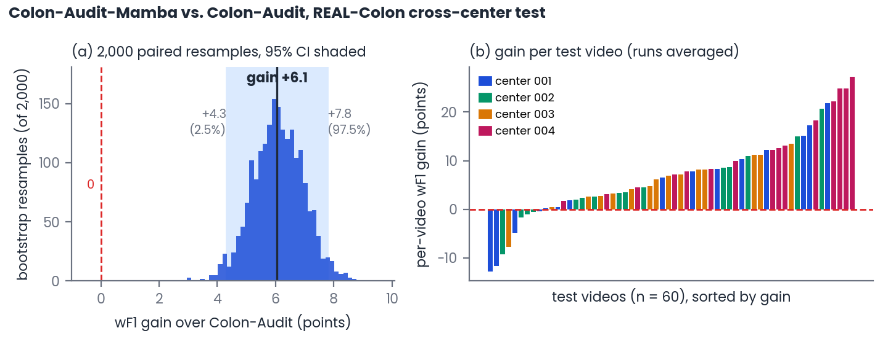

# How the confidence intervals are computed

The paper reports differences between two models as **gain [low, high]**, for example

> Colon-Audit-Mamba outperforms the online Colon-Audit by 6.1 wF1 points on the cross-center protocol
> (95% CI [+4.3, +7.8]).

- **Gain (6.1):** the wF1 of model A minus the wF1 of model B, on the same test videos. A positive value means
  that A is better.
- **[+4.3, +7.8]:** the 95% confidence interval of that gain, obtained with a paired video-level bootstrap.
- **Reading it:** if the interval does not include 0, the difference is significant. If it includes 0 (for
  example [−0.9, +2.9]), neither model can be said to be better.

This page explains the procedure with that example.

<p align="center">
  
</p>

**Figure.** Colon-Audit-Mamba (causal, 5 training runs) vs. the online Colon-Audit, REAL-Colon cross-center
test (60 videos).
- **(a)** The 2,000 bootstrap gains. The shaded band is the 95% CI and the dashed red line marks 0, which lies
  well outside the interval.
- **(b)** The gain on each test video. Colon-Audit-Mamba is better on 51 of the 60 videos and worse on a few,
  so the overall gain varies depending on which videos are in the test set. The bootstrap measures that
  variation.

## Procedure

**Step 1: the gain on the real test set.**
1. For each training run of Colon-Audit-Mamba, the frames of the 60 test videos are pooled and the wF1 is
   computed. The wF1 of Colon-Audit is computed in the same way.
2. The gain of each run is its wF1 minus that of Colon-Audit.
3. The gains of the 5 runs are averaged: **+6.06**, which rounds to +6.1.

**Step 2: 2,000 bootstrap resamples.** The question is how much the gain would change with a different set of
test videos.
1. Draw 60 videos at random **with replacement** from the 60 test videos. Some videos appear twice or more and
   others not at all.
2. Repeat step 1 on that sample: pool the frames of the drawn videos (a repeated video counts twice), compute
   both wF1 values and their gain, and average over the runs.
3. Repeat 2,000 times (random seed 0). This gives 2,000 gains, the histogram in panel (a).

**Step 3: the interval.** Sort the 2,000 gains. The 2.5th percentile (**+4.3**) and the 97.5th percentile
(**+7.8**) are the limits of the 95% CI: 95% of the resamples fall between them.

## Why paired

In every resample, **both models are evaluated on the same drawn videos**.
- **Shared difficulty cancels out:** if a resample contains many difficult videos, both models score lower,
  but their difference stays stable.
- **Narrower intervals:** the CI is therefore narrower than one obtained by evaluating each model separately,
  and it shows differences that overlapping per-model intervals or box plots would hide.
- **Paired runs:** when both models have several training runs (for example the ablations in Table 2), the
  runs are paired by seed and the gain is averaged over the pairs. When one model has a single set of
  predictions (Colon-Audit), each run is compared with it.

## Details

- **Resampling unit:** the video, not the frame. Frames of the same video are strongly correlated, so
  resampling frames would give intervals that are too narrow.
- **Rounding:** the gain and its limits are computed from unrounded values and rounded once, when reported.
  For this reason, a gain can differ by 0.1 from the difference of two rounded wF1 values.
- **Variability measured:** the interval reflects which videos are in the test set. The variation between
  training runs is reported separately as mean ± std.

## Reproduce

The function is `paired_bootstrap()` in [evaluation/metrics.py](../evaluation/metrics.py), used by
`evaluation/paper_tables.py`. The figure is generated with:

```bash
python evaluation/bootstrap_figure.py --protocol 4fold
```

It needs the released frame-level predictions ([models.md](models.md)) in `OUTPUT_DIR` and the Colon-Audit
predictions in `COLON_AUDIT_DIR`. It prints the gain and the CI, which match the paper, and writes
`figures/bootstrap_ci.png`.
